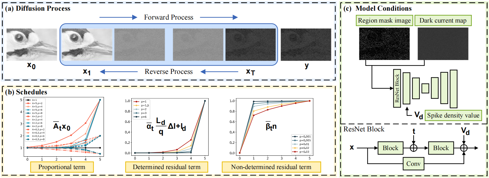

# Noise-Modeled Diffusion Models for Low-Light Spike Image Restoration (ICCV 2025, Highlight🌟)
<h4 align="center">Ruonan Liu, Lin Zhu, Xijie Xiang, Lizhi Wang, Hua Huang</h4>

## 🎯Introduction

This study proposes a novel approach for **restoring low-light spike images using noise-modeled diffusion models**.
By establishing a **noise-embedded spike imaging model** under low light, we **model the forward diffusion process as the degradation of spike images** with proportional and residual terms and incorporate deterministic and non-deterministic components with reverse shifting, enabling the model to capture the distinctive spike noise structure.
**Region mask images**, **dark current maps**, and **spike density values** guide restoration by indicating degradation areas, deterministic parameters, and noise intensity.
Experimental results demonstrate that our method significantly outperforms existing spike-based reconstruction and diffusion-based image restoration methods.

<p align="center">
  
</p>

## ✨News
- **[2025-09-23]** Code & dataset released.
- **[2025-07-15]** Paper accepted by ICCV 2025 (Highlight). 

## ⚙️Reqirements
- python=3.10
- pytorch=2.4.1
- tensorboard
- lpips
- pyiqa

You can quickly set up the environment using the following commands:
```
conda create -n spike_diffusion python=3.10 -y
conda activate spike_diffusion
pip install torch==2.4.0 torchvision==0.19.0 torchaudio==2.4.0 --index-url https://download.pytorch.org/whl/cu118
pip install -r requirements.txt
```

## 🗂️Datasets
- **Training Dataset**: Please download DF2K ([DIV2K](http://data.vision.ee.ethz.ch/cvl/DIV2K/DIV2K_train_HR.zip), [Flickr2K_HR](https://cv.snu.ac.kr/research/EDSR/Flickr2K.tar)) and organize as follow:
```
DF2K/
  |- train/
      |- DIV2K_train_HR/
          |- 0001.png
          |- ...
          |- 0784.png
      |- Flickr2K_HR/
          |- 000001.png
          |- ...
          |- 002634.png
```
- **Validation Dataset**: [OneDrive](https://1drv.ms/u/c/d7ca46a8d1a0a9a4/EQIRDg_3aeVGhUX2cPDWkKIBf7O5QeJy9mR2_jB-zGeFqw?e=pjJfA5) / [BaiduDisk](https://pan.baidu.com/s/1SH__3zTCiAkn3poudqPzcQ?pwd=viaa).
```
simulated_spike_data/
  |- val/  # validation during training
      |- 000.npy
      |- ...
      |- 287.npy
  |- val_paper/  # evaluation during inference for better visualization
      |- 00_competition.npy
      |- ...
      |- 09_police.npy
```

- **Real-world Low-light Spike Dataset**: [OneDrive](https://1drv.ms/u/c/d7ca46a8d1a0a9a4/ERYwpVzDK4VJh-wjMSdmyzMB-QRqVTRssDPnm_5lHPTAxQ?e=Hb15aj) / [BaiduDisk](https://pan.baidu.com/s/1ti0rT3sLWao3iiPYrEgxbQ?pwd=v7vx).
```
real_low_light_spike_data/
  |- data/  # real-world low-light spike data
      |- 01_soft_toy.npy
      |- ...
      |- 10_calendar.npy
  |- params/  # for calculating FPN parameters
      |- 0.npy
      |- 198.npy
      |- 423.npy
```
- Path mapping in configuration file `params.json`：
```
"dataset": {
	"dataset_train_root": "DF2K/train",
	"dataset_val_root": "simulated_spike_data/val",  // or "simulated_spike_data/val_paper"
	"dataset_real_root": "real_low_light_spike_data/data",
	"dark_data_path": "real_low_light_spike_data/params/0.npy",
	"medium_data_path": "real_low_light_spike_data/params/198.npy",
	"light_data_path": "real_low_light_spike_data/params/423.npy",
}
```

## 🚀Inference
- **Checkpoint**: [OneDrive](https://1drv.ms/u/c/d7ca46a8d1a0a9a4/Ee5vl8XTqsdFhhi6cRVIpP8BqkPrIPlBJRUxqe-D0LMhxg?e=Y1CPra) / [BaiduDisk](https://pan.baidu.com/s/1gce2oSLi11178aHgcYgpwA?pwd=bupe).
```
python test.py --config config/params.json
```

## 🤖Training

```
python train.py --config config/params.json
```
  
## 💌Acknowledgement
This project is built upon [RSIR](https://github.com/BIT-Vision/RSIR), [ResShift](https://github.com/zsyOAOA/ResShift), [DDPM](https://github.com/w86763777/pytorch-ddpm). Thanks for their help and inspiration.
